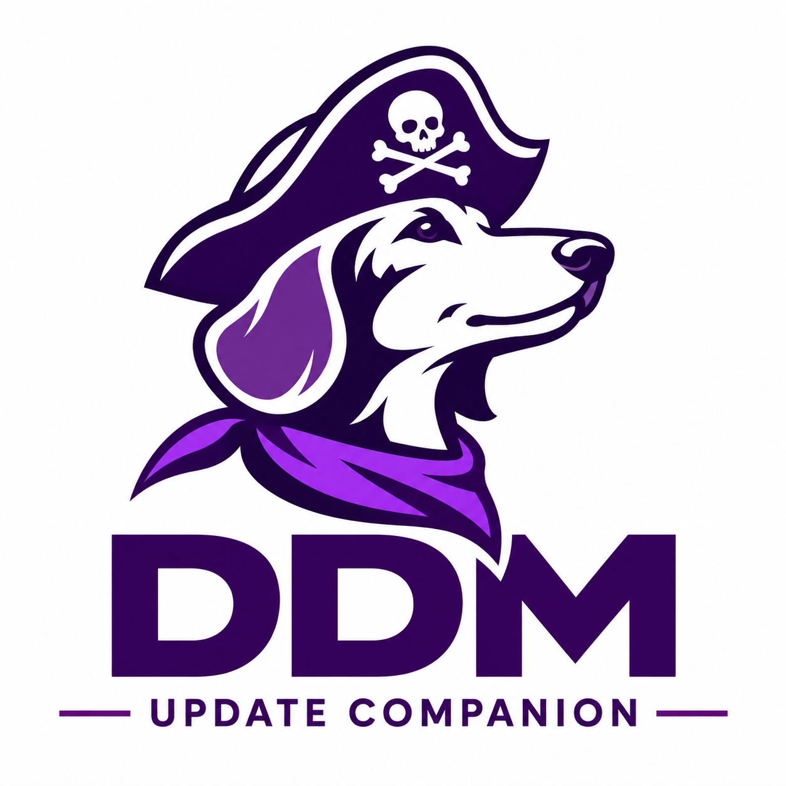

# DDM Update Companion

  

Your helpful update companion: a friendly watchdog that keeps macOS update deadlines in sight and helps you get to Software Update.

A macOS menu bar app that shows a compact popup for updates enforced through Declarative Device Management (DDM).

The reminder stays near the upper-right corner of the active screen and shows the required macOS version, deadline, and time remaining. Users can open Software Update, request another reminder, or visit your support website. macOS and the MDM service enforce installation; this app provides the reminder interface.

## Features

- Automatic detection of pending DDM software updates.
- Compact floating reminders and a menu bar countdown.
- Customizable reminder text, branding, and timing.
- Deadline-aware reminders, persistent deferrals, and quiet hours.
- Managed configuration support, settings export, and reminder previews.

See the [documentation](Documentation/wiki/Home.md) for configuration options and detailed behavior.

## Quick start for macOS administrators

1. Deploy the release app or installer to `/Applications`.
2. Choose your settings workflow:
   - **Jamf Pro:** Download the raw [JSON schema](Configuration/com.ecubrooks.DDMUpdateCompanion.json) and use it in Application & Custom Settings.
   - **Configure visually:** Open Preferences → Save & Preview → Copy Settings, save the copied XML as a `.plist`, and upload it to your MDM's custom preferences payload.
   - **Complete profile:** Customize the [example mobileconfig](Configuration/DDMUpdateCompanion.example.mobileconfig).
3. Use preference domain **`com.ecubrooks.DDMUpdateCompanion`**. Include only keys you want to enforce.
4. Configure login startup and deploy any logo separately.
5. Send the actual macOS update enforcement policy through MDM and validate on a pilot Mac.

Follow the [step-by-step configuration guide](Documentation/wiki/Managed-Configuration.md). JSON/PLIST settings alone do not install the app, start it, or schedule an OS update.

## Requirements and status

- macOS 15 or later; run in the logged-in user's desktop session.
- Source builds have been verified with Xcode 27.1. Older toolchains have not been verified; Xcode is not needed to run a distributed app.
- An MDM-managed test Mac with an applicable software update enforcement declaration for live validation.

A signed release build has been produced and verified by the maintainer using the release scripts. Initial live testing has been performed with an Xcode build. Packaging and further testing of the installed release are in progress; broad fleet and cross-MDM compatibility are not yet established.

## Installation from a release

When a release is published, download the `.pkg` or app ZIP attached to its GitHub Release. GitHub's automatic source-code ZIP is not an installable app.

The installer places `DDMUpdateCompanion.app` in `/Applications`. For the app ZIP, extract it and move the app to `/Applications`. The current packaging script installs only the app: it does not install a LaunchAgent, configuration profile, or logo. Open the app once and configure Launch at login, or deploy the optional LaunchAgent separately through MDM. Use one startup method.

Release notes should identify the app version/build, tested macOS versions and CPU architectures, signing/notarization results, SHA-256 checksums, and known limitations. This repository does not yet establish that a published binary has passed those checks.

## Build from source

1. Open `DDMUpdateCompanion.xcodeproj` in Xcode and select the **DDMUpdateCompanion** scheme.
2. Select your own signing team or **Sign to Run Locally** in Signing & Capabilities, then build and run on **My Mac**. The shared scheme has Display-Only Mode arguments disabled for live DDM testing.
3. Open the menu bar menu and choose **Preferences…**. If the icon is hidden because no update is pending, open the app again. The `--preferences` launch argument opens Preferences directly.
4. Configure and save your preferences, or deploy a managed profile from [Configuration](Configuration/README.md).
5. Schedule an applicable DDM update through your MDM and allow up to 60 seconds after the local state arrives for the app to refresh.

To preview the design without a real update, choose **Save & Preview** in Preferences. Preview buttons close the sample; they do not start an update.

## Documentation

Documentation is readable directly in this repository; publishing a separate GitHub Wiki is optional. These files are not needed inside the app or installer. Installation, Preferences, managed configuration, and troubleshooting are the main administrator guides; the pilot checklist helps validate your deployment.

- [Wiki home](Documentation/wiki/Home.md)
- [Installation and deployment](Documentation/wiki/Installation.md)
- [Preferences](Documentation/wiki/Preferences.md)
- [Managed configuration](Documentation/wiki/Managed-Configuration.md)
- [DDM behavior](Documentation/wiki/DDM-Integration.md)
- [Pilot deployment checklist](Documentation/wiki/Testing.md)
- [Troubleshooting](Documentation/wiki/Troubleshooting.md)

## Configuration files

| File | Purpose |
| --- | --- |
| `Configuration/com.ecubrooks.DDMUpdateCompanion.json` | Jamf custom settings schema |
| `Configuration/DDMUpdateCompanion.example.mobileconfig` | Example managed app preferences |
| `Configuration/com.ecubrooks.DDMUpdateCompanion.agent.plist` | Optional example login LaunchAgent |

Preference domain: `com.ecubrooks.DDMUpdateCompanion`. Runtime deferrals are kept separately in `com.ecubrooks.DDMUpdateCompanion.state`.

## How detection works

The app reads `/var/db/softwareupdate/SoftwareUpdateDDMStatePersistence.plist`, extracts applicable target versions and deadlines, and ignores entries under `invalidDeclarations`. It filters installed targets and chooses the earliest upcoming deadline, or the most recent overdue deadline when none are upcoming.

This persistence file is an internal macOS implementation detail, not a public app API. Validate readability and parsing on every macOS release you deploy. A read failure appears in Preferences and does not discard a previously detected update. A successful read with no applicable target clears the reminder immediately. A previously detected reminder survives two consecutive missing-file checks and clears on the third.

## History

DDMUpdateCompanion implements macOS update reminders with a focus on popup presentation and menu bar interaction.

DDM Update Companion grew out of my work on my own Software Update Prompt project and a GitHub fork of [DDM OS Reminder](https://github.com/dan-snelson/DDM-OS-Reminder). I wanted a smaller popup notification that could sit in the upper-right corner of the screen rather than interrupting the user with a large, in-your-face popup. While I worked on fork and looking over my previous project, I started to realize the project's scope had become more complex than I wanted for a simple macOS update reminder.

I decided to take a different direction and build a native Swift app. Around that time, I had started spending more time in Xcode and experimenting with its Codex integration. That gave me an opportunity to rethink the interface and build what I felt would be a better more streamlined experience.

The [SUMB project](https://github.com/jeremy4971/sumb_public) also influenced the development of DDM Update Companion, particularly by helping me streamline some of the application's Preferences settings. The goal was to keep the reminder compact and approachable but let macOS administrators customize its behavior for their environments.

See Apple's [software update enforcement documentation](https://developer.apple.com/documentation/devicemanagement/softwareupdateenforcementspecific) for the underlying MDM declaration.

## Acknowledgments

- Thanks to Dan Snelson's [DDM OS Reminder](https://github.com/dan-snelson/DDM-OS-Reminder) for inspiring the idea for this project's update reminders.
- Thanks to the [SUMB project's wiki](https://github.com/jeremy4971/sumb_public/wiki) for helpful guidance on configuring software update enforcement profiles.

## Privacy and local data

The current app reads local DDM state and the installed macOS version/build. It stores preferences and reminder deferrals locally and writes DDM read failures to macOS unified logging. It contains no analytics uploader or direct MDM-server client. Opening the configured support link uses the default browser; that website has its own privacy practices. Software Update and MDM network activity are handled by macOS and your management tools.

Before posting diagnostics, remove organization names, internal URLs, device identifiers, and any private information from logs, profiles, and screenshots. Use GitHub Issues for reproducible bugs with sanitized details; do not post credentials or private keys.

## Limitations and compatibility

- The internal DDM persistence file may change between macOS releases. A configured minimum of macOS 15 is not a claim of fleet validation on every later OS.
- The app does not install macOS updates, postpone the MDM deadline, or prove installation/compliance. Removing a declaration also clears its reminder.
- No Notification Center notifications, meeting/Focus detection, weekly scheduling grid, automatic app updater, or SUMB/DDM OS Reminder profile import is implemented.
- Profiles must use this app's domain and case-sensitive keys; similar settings in other reminder tools are not interchangeable.
- During DDM read failures, the countdown and reminder rules continue using the last known deadline and current profile settings. Preferences reports the error and last successful read time. This cache lasts only for the running app session.
- Copy Settings exports the 16 GUI fields. Nine additional profile-only settings are configured through profiles or local defaults; see the configuration reference.

## License and redistribution

Released under the [MIT License](LICENSE). Copyright (c) 2026 Brooks Person. Anyone may use, modify, and redistribute the software, including commercially, provided the copyright and license notice are retained. The software is provided without warranty.
